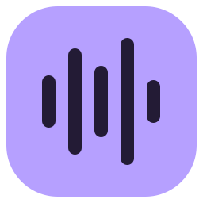
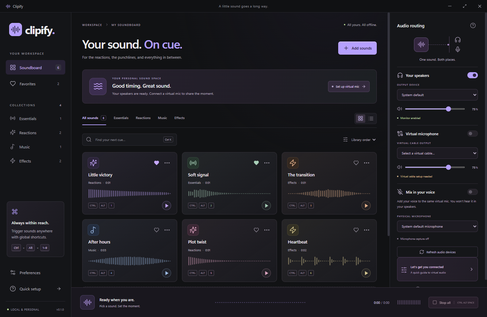

<p align="center"></p>
<h1 align="center">Clipify</h1>
<p align="center">Your sound. On cue.</p>
<p align="center">A personal Windows soundboard for reactions, punchlines, and everything in between.</p>



## What it does

- Import local MP3, WAV, OGG, FLAC, M4A, AAC, and WebM audio, up to 30 MB and 5 minutes per clip. Codec support depends on the bundled Chromium decoder.
- Play sounds with one click or an editable global shortcut, even while another app is focused.
- Send the same clip to physical speakers/headphones and a separate virtual audio cable.
- Optionally mix a physical microphone into that cable. Voice is never monitored through the speakers.
- Organize sounds into four collections, search, favorite, rename, recolor, sort, and switch between grid and list views.
- Adjust clip/output/voice volume, loop clips, and choose single or overlapping playback (up to 16 sounds).
- See waveforms derived from the actual audio and a live clip level meter.
- Keep a persistent, offline library with private copies of imported audio. Six original synthesized sounds are included.

## Run on Windows

Open `release/Clipify-0.2.1-win-x64.exe` for the portable build, or use the unpacked build at `release/win-unpacked/Clipify.exe` if available. No development tools are needed to run a packaged build.

Generated executables are excluded from the source repository. When cloning the project, run `npm run package` after installing dependencies to create your own Windows build. The Windows CI workflow also produces a downloadable executable artifact.

For development, install **Node.js 24 LTS** and use Windows 10/11 x64:

```powershell
npm ci
npm run dev
```

`npm ci` also downloads the Electron runtime. The development server binds only to `127.0.0.1`.

```powershell
npm run build          # Type-check and build the renderer
npm start              # Run the built desktop application
npm test               # Storage, validation, synthesis, and audio-engine tests
npm run test:desktop   # Real Electron integration tests and screenshots
npm run test:package   # Read-only launch check of the unpacked production executable
npm run package        # Build a portable Windows x64 executable
npm run package:dir    # Build an unpacked Windows application
```

`test:desktop` opens a temporary app window, plays quiet synthesized test tones, and uses isolated data under `.local-test/`. `test:package` also uses a fresh isolated profile, with virtual routing and microphone capture off. Neither test edits the normal library. Python with Pillow is needed only to regenerate the optional icon assets using `python scripts/create-icon.py`; generated icons are already included.

## Hear clips in speakers and a microphone input

A normal Windows application cannot turn a physical microphone into an output device. Clipify uses an installed **virtual audio cable** as a microphone endpoint for other apps. It does not ship or silently install a kernel driver.

1. Install [VB-CABLE from VB-Audio](https://vb-audio.com/Cable/) and restart Windows if requested.
2. In Clipify’s **Your speakers**, choose your physical speakers or headphones.
3. In **Virtual microphone**, select **CABLE Input (VB-Audio Virtual Cable)** and enable its switch.
4. In Discord, a game, or a call app, choose **CABLE Output (VB-Audio Virtual Cable)** as the microphone.
5. **Mix in your voice** is enabled by default and uses **System default microphone**. It starts automatically when virtual routing is connected. You can choose another physical microphone or turn voice mixing off; both choices are remembered. Keep the Windows default microphone set to a physical microphone rather than the cable’s recording endpoint to avoid feedback.

These playback/recording names follow [VB-Audio’s reference manual](https://vb-audio.com/Cable/VBCABLE_ReferenceManual.pdf). Other virtual devices can work too; select the corresponding playback and recording endpoints.

Clipify remembers device names alongside their IDs. If Windows changes an ID after a restart or driver update, Clipify reconnects only when the remembered name has one matching device. A missing or ambiguous match leaves the cable off so you can select it again; a different channel layout is not substituted.

Use **Refresh audio devices** after connecting hardware or installing a driver. This requests microphone access briefly to expose device labels, then immediately stops that temporary stream. Output device selections, volumes, virtual routing, and the voice mixing switch are remembered and restored automatically on launch. Voice mixing defaults to enabled with the system default microphone, and capture starts only when virtual routing is connected. A missing cable leaves virtual routing and capture off and shows an explanation; speaker recovery is handled independently. Disconnecting the cable stops voice capture and disables cable routing.

## Shortcuts

| Action | Shortcut |
| --- | --- |
| Play / stop an assigned clip | `Ctrl + Alt + 1–9` or `Ctrl + Alt + A–Z` |
| Stop all clips globally | `Ctrl + Alt + Space` |
| Search the library | `Ctrl + K` |
| Stop clips while Clipify is focused | `Esc` |

Use a sound’s `…` menu to change its shortcut. Preferences reports shortcuts reserved by another app. Stop all stops sound effects; use the voice switch to mute a live microphone.

## Project layout

```text
electron/
  main.cjs                  Window lifecycle, trusted protocol, IPC, global hotkeys
  preload.cjs               Narrow, typed bridge to the isolated renderer
  services/
    library.cjs             Imports, private audio copies, serialized atomic persistence
    validation.cjs          Clip and routing validation
    synthesis.cjs           Deterministic original starter sounds
src/
  audio/AudioEngine.ts      Decode/cache, dual audio buses, looping, optional mic mix
  hooks/useSoundboard.ts    App state, devices, persistence, audio lifecycle
  components/              Reusable cards, routing, editor, setup, transport, icons
  App.tsx                   Workspace navigation, filters, preferences
  styles.css                Design tokens, interaction states, adaptive desktop layout
scripts/                    Development, icon generation, desktop verification
tests/                      Focused storage and audio behavior tests
docs/                       Architecture, verification notes, screenshot
```

See [architecture](docs/architecture.md) for audio flow and trust boundaries, [verification](docs/verification.md) for checks and practical limits, and the [publication review](docs/publication-review.md) for the final release-readiness assessment.

## Data and recovery

The app stores `library.json` and copied audio in `%APPDATA%\Clipify`. Back up this folder with Clipify closed. Settings and metadata writes are serialized and saved with a temporary-file rename. The app preserves an unreadable library rather than replacing it. Removing a sound removes the catalog entry; its private audio copy is retained for recovery, so library removal does not reclaim disk space automatically. Your original files are never modified.

## Troubleshooting

- **I can hear it, but others cannot:** enable Virtual microphone, then choose the cable’s recording device in the other app. Voice-app noise suppression may reject music and sound effects; adjust the other app’s processing settings.
- **No virtual cable in the list:** install a compatible driver yourself, restart if required, and refresh devices. A physical microphone cannot be used as a playback output.
- **Feedback / doubled audio:** use physical headphones as the monitor, a physical mic as the voice source, and the virtual cable only for the chat input. Do not enable Windows “Listen to this device” for the same route.
- **No microphone access:** check Windows microphone access for desktop apps, then select a connected microphone. Clipify does not change Windows privacy settings.
- **A file will not play:** it may be corrupt, use an unsupported codec, or exceed five minutes. Convert it to PCM WAV, MP3, or OGG and import it again. An unplayable import stays visible so you can remove it through its edit menu.
- **The two outputs sound slightly apart:** separate Windows output devices have independent hardware buffers. Both routes share one Web Audio source, but this is not a sample-synchronized professional audio driver.

## Copyright and permissions

Copyright (c) 2026 rm-rf-sanity. **All rights reserved.** No license is granted for the original Clipify code, documentation, artwork, or original starter sounds. See [COPYRIGHT](COPYRIGHT). This repository is not offered under an open-source license. This notice does not revoke rights validly granted for earlier copies.

Electron, React, Lucide, and other independent dependencies retain their respective licenses; see [third-party notices](THIRD_PARTY_NOTICES.md). The copyright notice and dependency notices are included in the Windows package. VB-CABLE is separate third-party software with its own terms. Windows builds are unsigned development builds.

Personal imported sounds and the user's catalog are not included in the repository or build. They stay in the user's local data folder; audio files and catalogs are ignored by Git.
