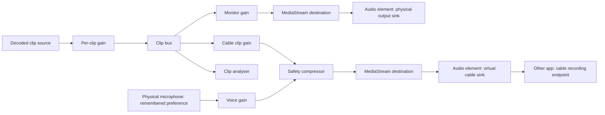

# Architecture

Clipify separates native capabilities, application state, audio behavior, and presentation. All application code and UI text are in English.

## Audio flow

There is one `AudioContext` and one `AudioBufferSourceNode` per active clip. Each clip source feeds both output buses. Two `HTMLAudioElement` sinks select their respective Windows output devices using `setSinkId`. Nothing connects to `AudioContext.destination`, preventing accidental implicit output to the system default. Hardware synchronization between separate devices is not guaranteed.

The cable bus combines clip audio and optional physical microphone input before compression. Microphone audio has no connection to the monitor bus or the clip meter. Clip output volume and voice gain are independent. A cache retains at most 12 decoded files and 128 MiB of decoded sample data; larger individual clips can play without being cached. Active playback and in-flight decoding require additional memory. Analysis is sequential and in-flight reads are deduplicated. Per-request cancellation prevents a pending decode from starting after Stop all, while overlap mode permits independent clips to load concurrently.

Virtual routing requires an explicit non-default device ID. Saved output devices, gains, routing, and the voice mixing preference are restored at startup. Voice mixing defaults to enabled with the system default microphone; a capture stream starts only when the saved preference is enabled and a cable route is connected. A user can mute voice mixing and the disabled preference persists. Speaker and cable recovery are independent: a missing speaker falls back to the system output, while a missing cable disables virtual routing and capture with an explanation. Changing the cable or mic stops the old capture stream; the remembered preference is then applied to the new route. Device removal shuts down the relevant route, and an unavailable cable is never automatically redirected to physical speakers.

Muting voice stops capture immediately, before queued output configuration or disk persistence completes. It also cancels capture that is still starting.

## Native boundary

The Electron main process owns file dialogs, storage, hotkeys, window controls, and a single allowlisted external link. A sandboxed, context-isolated renderer has no Node.js integration. The preload exposes individual functions, not arbitrary IPC or filesystem APIs. Every IPC handler checks the sender, main frame, and origin. The renderer receives sound IDs and metadata, never arbitrary filesystem access.

Production assets are served through the privileged `clipify://app` protocol with a directory traversal check. New windows and navigation to external origins are blocked. A restrictive CSP limits the renderer to bundled resources, blob media, and the local development socket. Audio permission checks are limited to the trusted application renderer; video permission requests are rejected. There is no analytics, remote renderer code, or automatic updating.

Imports are chosen with a native dialog, extension/size checked, and copied under random filenames. Clip IDs resolve only through the stored catalog. Original files are never edited. Codec validation happens in Chromium; files that fail decoding are reported when played. JSON saves use a serialized queue and a temporary file rename. Damaged catalog data is preserved and causes a startup error with the recovery path.

Development tests use `CLIPIFY_TEST_DATA` to select an isolated profile. Packaged verification additionally requires the explicit `--clipify-test-profile` flag; the environment variable alone never redirects a normal packaged launch. The package test creates a fresh profile and verifies that virtual routing and microphone capture remain off.

## Extending the app

- Add another output by adding a bus and sink in `AudioEngine`, a settings field and validator, and a routing UI control.
- Extend collections through the shared constants and backend allowlist.
- Add another file format only after testing the bundled Chromium decoder and adding it to the native picker and storage allowlist.
- Replace persistence behind `Library` without changing the renderer bridge contract.
- Reuse `Modal`, `Icon`, `Toggle`, and the shared design tokens for new settings and controls.
